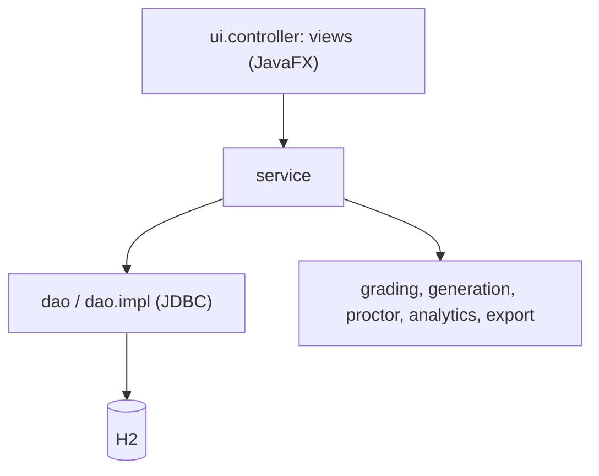
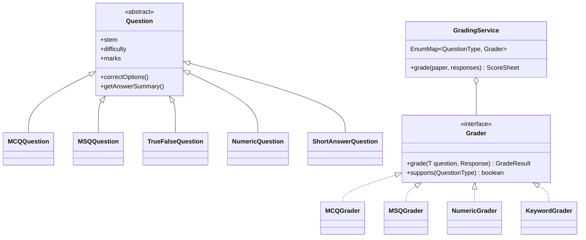
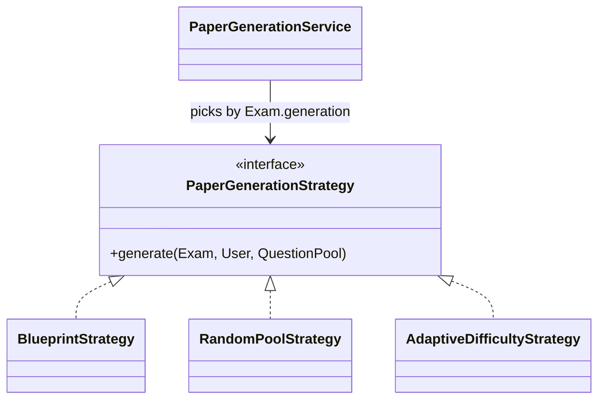
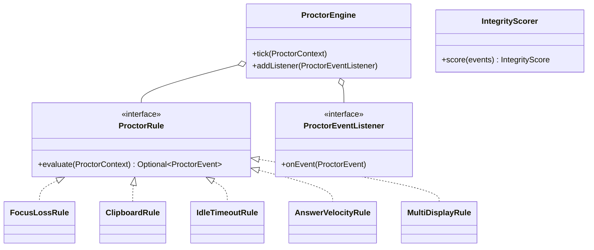
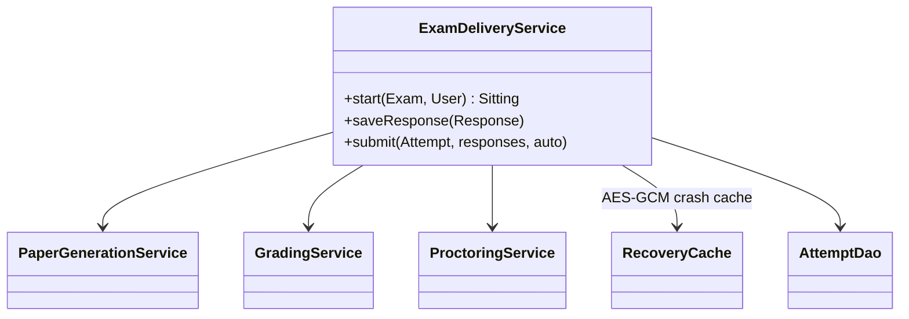

# Class diagrams

Layers, top to bottom: `ui` -> `service` -> `dao` -> H2. Everything else is a pure-logic
helper the services call (`grading`, `generation`, `proctor`, `analytics`, `export`).

## Layering

## Questions and grading (Strategy, polymorphic mapping)

## Paper generation (Strategy)

Papers are stable per student: the random seed is derived from exam id and student id.

## Proctoring (Observer / rule chain)

UI signals (focus, clipboard, idle) feed a `ProctorContext` snapshot each second; rules turn
snapshots into events; listeners (the database writer in `ProctoringService`, the banner in `ExamTakingView`) persist them and show the banner. `IntegrityScorer` caps each
event type so one noisy rule cannot zero a student on its own.

## Delivery

