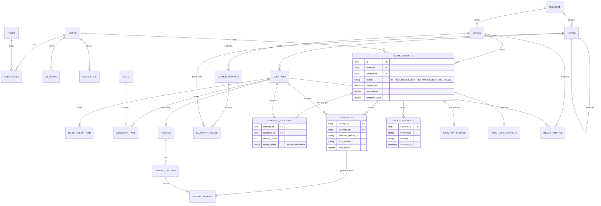

# Entity-relationship diagram

Mermaid renders this on GitHub and in most Markdown viewers. Tables come straight from
`SchemaDefinition`; only the columns that matter for the relationships are shown.

Design notes worth knowing when reading the schema:

- **The paper is frozen.** `attempt_questions` stores each student's question order and option
  order, so resuming (or auditing) always shows exactly what they saw.
- **Responses are upserted** (one row per attempt and question) by autosave; the final submit
  writes the remaining answers, closes the attempt and stores the scores in one transaction.
- **Soft delete** on subjects, topics, questions and users (`is_active`); exam history is never
  orphaned.
- **Integrity is separate from the submit commit.** A failure computing it can never lose a
  student's answers.
